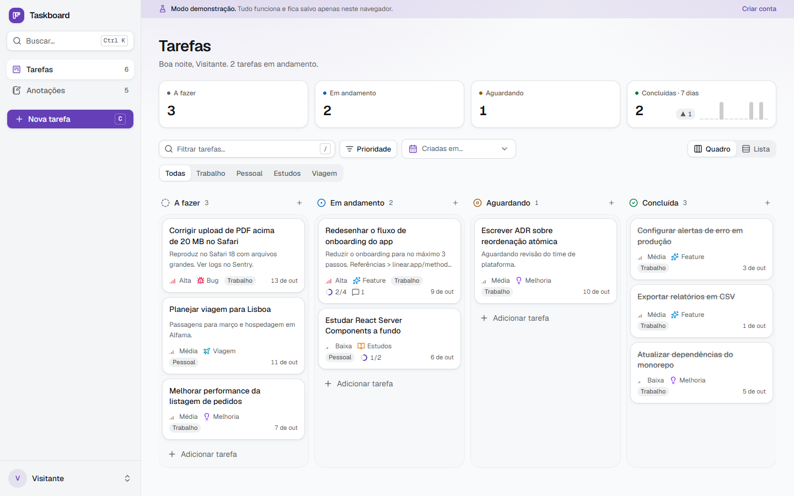
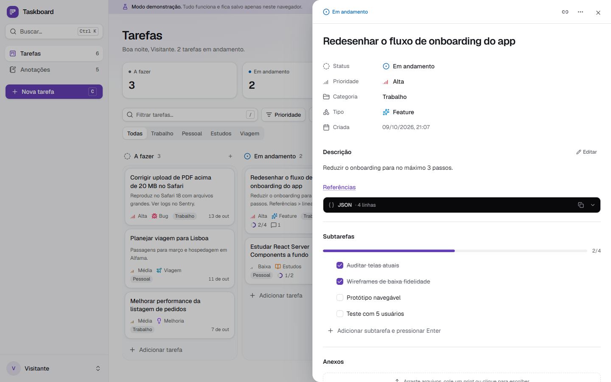
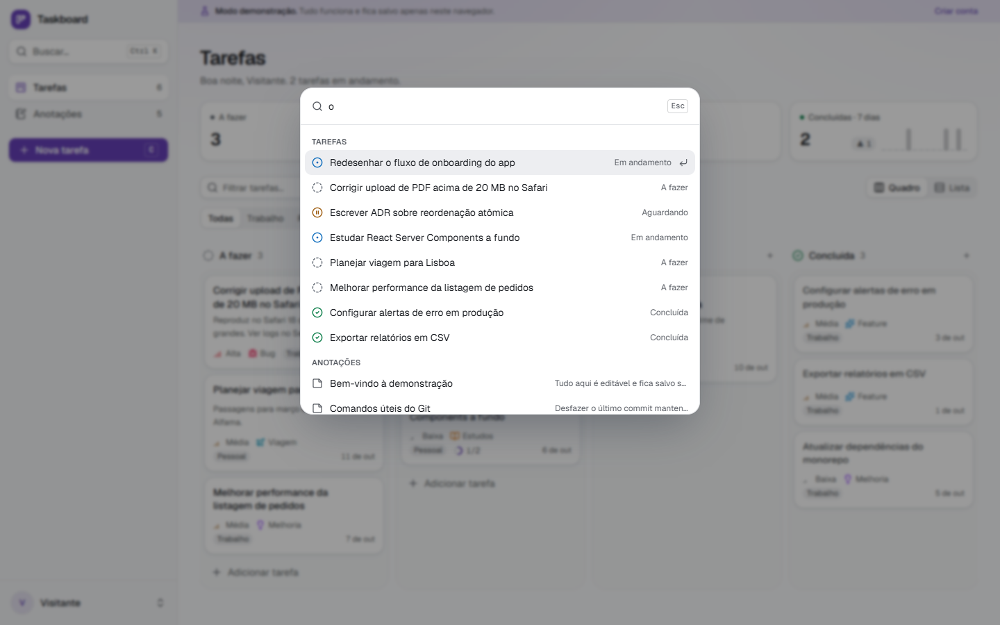
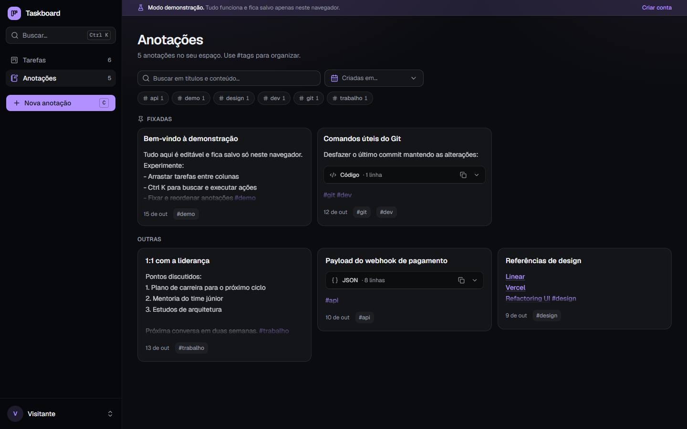
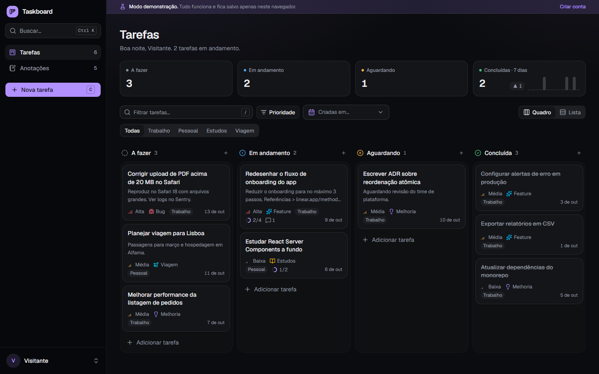
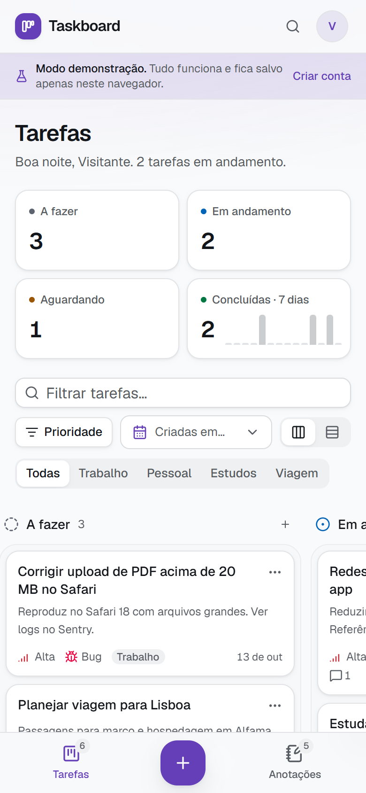

# Taskboard

[](https://github.com/cybermaique/taskodoro/actions/workflows/ci.yml)

Organizador pessoal de tarefas e anotações: quadro Kanban com arrastar e soltar (mouse, toque e teclado), painel de detalhes com edição inline, anotações com #tags e paleta de comandos. Feito com Next.js 16, React 19 e Supabase.

**Experimente sem criar conta:** a rota [`/demo`](app/demo/page.tsx) roda o app completo com dados de exemplo salvos só no seu navegador.



<table>
  <tr>
    <td></td>
    <td></td>
  </tr>
  <tr>
    <td></td>
    <td></td>
  </tr>
</table>

<p align="center"></p>

## Recursos

- **Quadro Kanban** com dnd-kit: arrastar entre colunas com mouse, toque (pressionar e segurar) e teclado (Espaço e setas), criação rápida por coluna e visualização em lista
- **Painel de detalhes** com edição inline de título, status, prioridade, categoria e tipo; descrição com links e blocos de código; subtarefas reordenáveis; anexos (colar print, arrastar ou escolher); comentários; histórico de status e de descrição
- **Anotações** em grade, com #tags, fixadas reordenáveis e anexos
- **Paleta de comandos** (`Ctrl K`) e atalhos de teclado (`C`, `/`, `1`, `2`, `?`)
- **Ações otimistas** com rollback: mover, concluir e excluir respondem na hora; excluir oferece "Desfazer"
- Indicadores do quadro com conclusões dos últimos 14 dias
- Temas claro, escuro e conforto, cor de destaque por usuário e densidade compacta

## Decisões técnicas

**Dados no servidor, uma vez.** `app/page.tsx` é um Server Component que autentica e carrega tarefas, anotações e perfil em paralelo. O `proxy.ts` renova a sessão do Supabase a cada requisição, então Server Components e Route Handlers sempre veem um token válido. O cliente nunca refaz essa busca.

**Segurança em camadas.** O limite de acesso é o **Row Level Security** do Postgres: cada linha pertence a um usuário e as tabelas filhas herdam o acesso. Por cima disso, toda rota passa por `withAuth` (401 explícito) e valida o corpo com **zod**: campos desconhecidos são descartados, e a URL do avatar só aceita `null` (uploads passam por uma rota própria). Anexos de HTML e SVG nunca são servidos inline, para não executar scripts na origem do app.

**Estado do cliente com rollback.** `WorkspaceProvider` expõe dados, ações e estado de interface em contextos separados (ações estáveis não re-renderizam quem só lê dados). Cada ação aplica a mudança na hora e reverte se a API falhar. Escritas de ordenação passam por uma fila, para que arrastes rápidos cheguem ao servidor em sequência.

**Reordenação atômica.** Mover um card reescreve posições. Em vez de N `UPDATE`s paralelos sem transação, funções Postgres (`reorder_tasks` e afins, `security invoker`) fazem um único `UPDATE` com `unnest ... with ordinality`. Se a migration ainda não foi aplicada, a chamada cai automaticamente no caminho antigo (`PGRST202`), então o deploy não depende da ordem.

**Transport e modo demonstração.** O provider não chama `fetch` diretamente: fala com um `Transport`. Em produção ele usa HTTP; na demo, um servidor em memória que **espelha as mesmas rotas**, valida com **os mesmos schemas zod** e simula os triggers do banco (históricos e timestamps). Isso permite uma demo pública sem conta e testes E2E no CI sem segredos.

**Lógica de domínio pura.** O cálculo de onde um card cai (`resolveDrop`) e da nova ordem global (`planTaskMove`) vivem em `lib/ordering.ts`, sem React nem rede, e são testados unitariamente, inclusive o caso de tarefas ocultas por filtro, que preservam a ordem relativa.

**Acessibilidade verificada, não presumida.** Os testes E2E rodam **axe (WCAG 2.2 AA)** nos temas claro e escuro. Eles encontraram problemas reais, todos corrigidos:
- arrastar entre colunas entrava em loop de atualização (`Maximum update depth exceeded`);
- a rotação do card flutuante desviava o arraste por teclado;
- excluir pelo menu deixava o quadro com `aria-hidden`;
- havia controles aninhados nos cards e contraste abaixo de 4,5:1.

Os anúncios do leitor de tela durante o arraste são em português e usam títulos, não ids.

**Hidratação estável.** Datas são formatadas com fuso fixo (`America/Sao_Paulo`), e o que depende do relógio do visitante (saudação, últimos 7 dias) só é calculado após a hidratação. Assim servidor e cliente renderizam o mesmo HTML.

**Design system em tokens.** Cores em `oklch` como variáveis CSS por tema; a cor de destaque do perfil muda só matiz e croma, e a luminosidade vem do tema, garantindo contraste em qualquer combinação. Sem cores fixas espalhadas pelos componentes.

### Trade-offs e próximos passos

- Todas as tarefas e anotações são carregadas de uma vez: simples e rápido para uso pessoal, mas pediria paginação ou virtualização com milhares de itens.
- Sem sincronização em tempo real entre abas ou dispositivos (Supabase Realtime seria o próximo passo).
- Tipos do banco são escritos à mão; o ideal é gerá-los com `supabase gen types`.
- Na demo, anexos e foto de perfil ficam desativados (não há storage).

## Arquitetura

```
app/
  page.tsx              Server Component: autentica e carrega os dados
  demo/                 Modo demonstração (sem conta, dados no navegador)
  login/                Entrada; redireciona se já houver sessão
  api/                  Route Handlers: withAuth + zod
proxy.ts                Renova a sessão do Supabase a cada requisição
components/
  workspace/            Provider de estado, shell, paleta e diálogos globais
  tasks/                Quadro, lista, card, painel de detalhes e criação
  notes/                Grade, card e editor de anotações
  ui/                   Primitivos acessíveis (Base UI + Tailwind)
lib/
  tasks.ts, notes.ts    Acesso a dados no servidor
  ordering.ts           Regras de ordenação (puras e testadas)
  api/schemas.ts        Contratos da API (zod), compartilhados com a demo
  transport.ts          HTTP ou demo
  demo/                 Servidor em memória e dados de exemplo
supabase/               Schema, migrations e scripts (veja supabase/README.md)
e2e/                    Playwright + axe
```

## Testes

| Comando | O que roda |
| --- | --- |
| `npm test` | Vitest: ordenação, servidor da demo, schemas, formatação, filtros e componentes |
| `npm run test:e2e` | Playwright em desktop e celular: fluxos da demo e auditoria axe |
| `npm run lint` / `npm run typecheck` | ESLint e TypeScript estrito |

O [CI](.github/workflows/ci.yml) roda tudo isso em cada PR. O job E2E usa a demonstração e não precisa de credenciais.

## Rodando localmente

```bash
npm install
npm run dev
```

Sem variáveis de ambiente, só `/demo` funciona. Para usar com sua conta:

1. Crie um projeto no Supabase e execute [`supabase/schema.sql`](supabase/schema.sql) no SQL Editor.
2. Crie `.env.local`:

```env
NEXT_PUBLIC_SUPABASE_URL=https://SEU-PROJETO.supabase.co
NEXT_PUBLIC_SUPABASE_ANON_KEY=sua_chave_anon
```

Em um banco já existente, aplique só as migrations pendentes. Veja [`supabase/README.md`](supabase/README.md).

## Stack

Next.js 16 (App Router, Server Components, `proxy.ts`) · React 19 · TypeScript · Tailwind CSS v4 · Base UI · dnd-kit · zod · Supabase (Auth, Postgres com RLS, Storage) · Vitest · Playwright · axe-core · GitHub Actions
